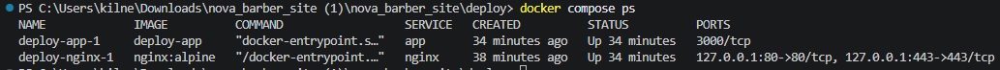
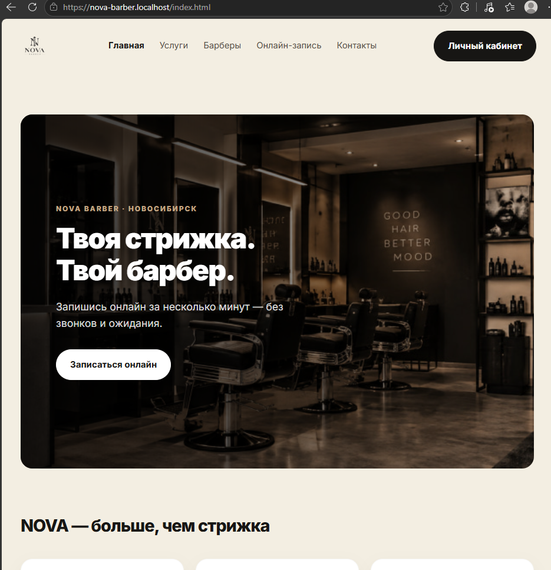
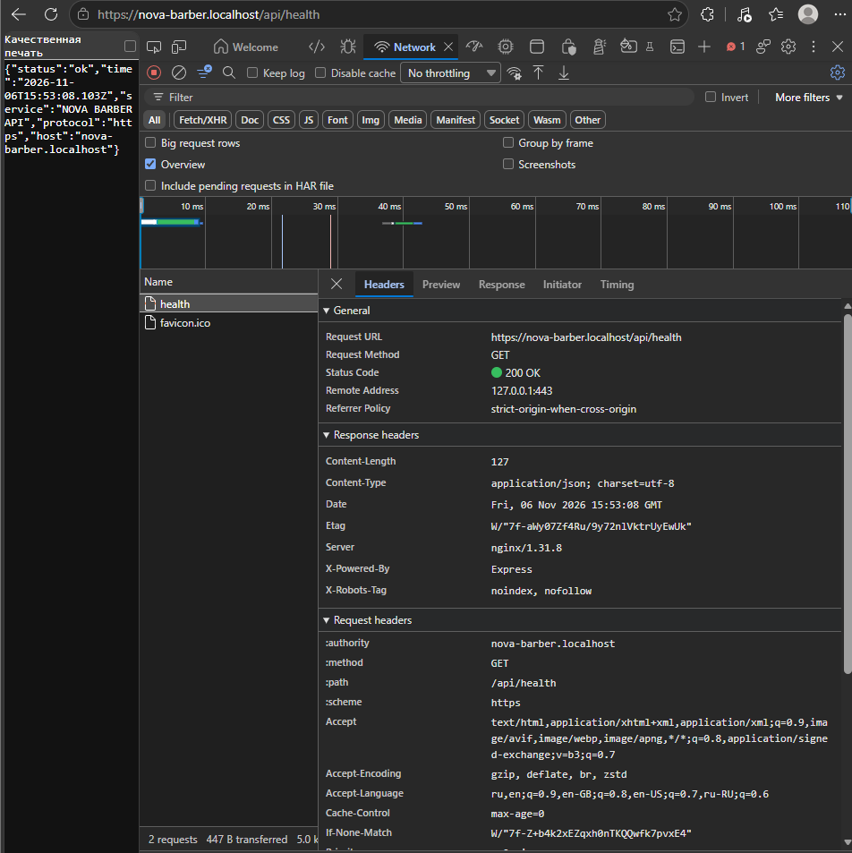
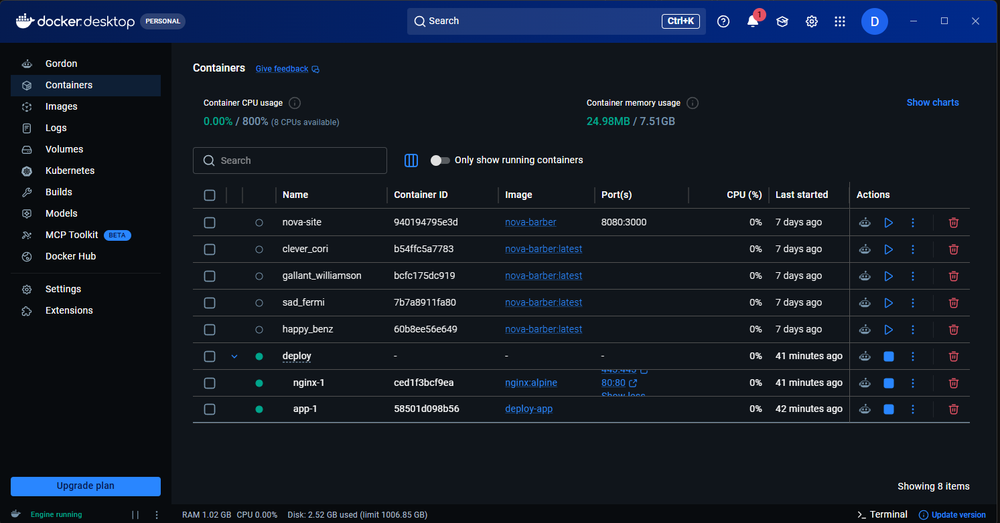
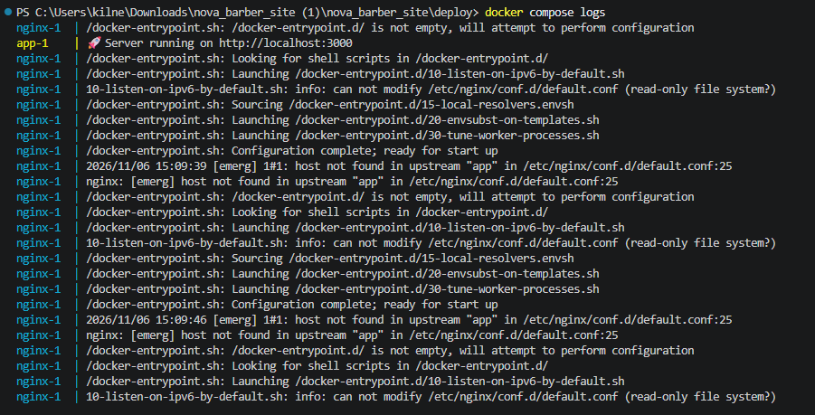

## Аудит Lighthouse (ПЗ № 19)

Полный отчёт аудита: [docs/audit/AUDIT.md](../docs/audit/AUDIT.md)

HTML-отчёты Lighthouse: [docs/audit/reports/](../docs/audit/reports/)

Краткие результаты (Desktop, Lighthouse 12.8.2, медиана 3 запусков):

- Performance: **98** на главной (диапазон по публичным страницам 94–99)
- Accessibility: **100** после исправлений (до исправлений 92–95)
- Best Practices: **100** на всех страницах
- SEO: **100** на всех публичных страницах

Core Web Vitals (главная, реальные взаимодействия): LCP = **0.58 s**, INP = **184 ms**, CLS = **0.065** — все три метрики в «зелёной» зоне.

В рамках аудита исправлены 4 проблемы приоритета P1: контраст текста подвала, контраст номеров шагов на странице записи, порядок заголовков (`h3` → `h2`) и домен-заглушка `example.com` в `robots.txt` / `sitemap.xml`.
